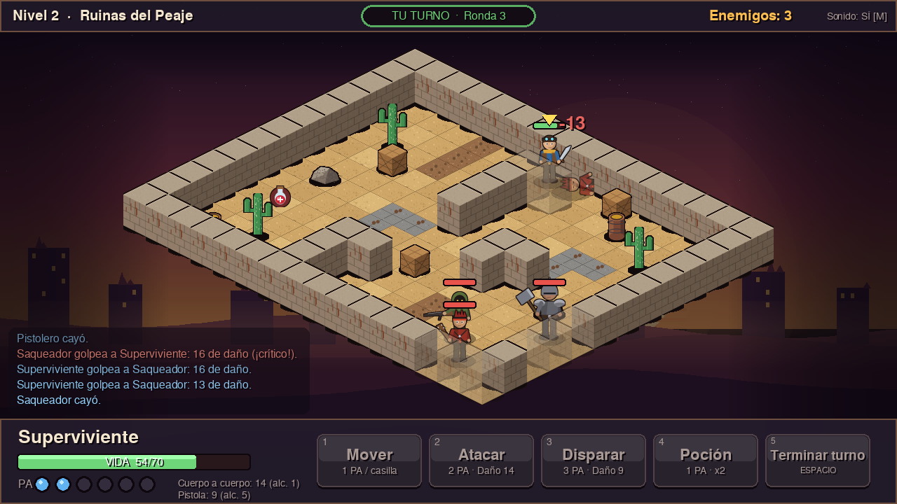

# Cenizas del Yermo — RPG isométrico por turnos

Juego 2D hecho con **Python + Pygame** para la materia *Creación de Videojuegos 2D* (Opción 2: RPG isométrico estilo *Wasteland*, complejidad media).

Sos un superviviente que atraviesa tres zonas del yermo. En cada una tenés que eliminar a todos los enemigos con combate táctico por turnos y puntos de acción (PA): moverte, golpear, disparar o curarte.



## Requisitos

- Python **3.10 o superior**
- **pygame-ce** 2.5.6 o superior (se instala con `requirements.txt`). Es un fork de Pygame con el mismo `import pygame`; funciona también con Python 3.13/3.14, donde `pygame` clásico no tiene instaladores.
- Una placa de sonido es opcional: si no hay, el juego corre igual, sin audio.

## Instalación y ejecución (paso a paso)

1. **Clonar el repositorio**
   ```bash
   git clone <URL-DEL-REPO>
   cd rpg-isometrico
   ```
2. **Crear un entorno virtual** (recomendado)
   - Linux / macOS:
     ```bash
     python3 -m venv .venv
     source .venv/bin/activate
     ```
   - Windows (PowerShell):
     ```powershell
     python -m venv .venv
     .venv\Scripts\Activate.ps1
     ```
3. **Instalar las dependencias**
   ```bash
   pip install -r requirements.txt
   ```
4. **Ejecutar el juego**
   ```bash
   python main.py
   ```
5. En el menú, click en **Comenzar Juego** (o `Enter`).

> Los assets (sprites, tiles, sonidos) ya vienen incluidos en `assets/`. Si querés regenerarlos: `python tools/generate_assets.py`.

## Cómo se juega

| Acción | Cómo |
|---|---|
| Mover | `1` y click en una casilla celeste (1 PA por casilla) |
| Atacar cuerpo a cuerpo | `2` y click en un enemigo adyacente (2 PA, daño 14). Atajo: click en un enemigo adyacente estando en modo mover |
| Disparar | `3` y click en un enemigo (3 PA, daño 9, alcance 5, necesita línea de visión) |
| Usar poción | `4` (1 PA, cura 28 de vida) |
| Terminar turno | `Espacio` / `Enter` / `5` |
| Cancelar modo | click derecho o `Esc` |
| Pausa | `Esc` |
| Sonido on/off | `M` |
| Pantalla completa | `F11` |

Tenés **6 PA por turno**. Cuando se acaban (o terminás el turno) juegan los enemigos. Si tu vida llega a 0 aparece **Game Over**; si derrotás a todos los enemigos de los 3 niveles, **Victoria**. Ambas pantallas permiten volver al menú.

## Estructura del proyecto

```
main.py                  punto de entrada
core/                    "motor" visto en clase
  game_object.py         GameObject: spritesheet + JSON de animaciones
  scene.py               Scene: base de todas las escenas
  game.py                Game: ventana y bucle INPUT / UPDATE / RENDER
  audio.py               AudioManager (SFX + música)
  ui.py                  Button, Panel, Bar (heredan de GameObject)
game/
  iso.py                 transformación ortogonal <-> isométrica
  levels.py              mapas como matrices de texto
  pathfinding.py         BFS y línea de visión
  entities.py            Entity, Player, Enemy, Collectible
  effects.py             partículas, textos flotantes, proyectiles
  hud.py                 panel de combate, barras de vida, indicador de turno
  tileset.py             carga de tiles
  scenes/                menu.py, play.py, end_screens.py (Game Over y Victoria)
tools/                   generate_assets.py, bot.py, record_demo.py
tests/                   test_logic.py, smoke_test.py, playthrough_test.py
docs/                    DISENO.md, ASSETS.md
assets/                  sprites, tiles, sonidos (generados por código)
demo/                    gameplay_demo.mp4
```

## Documentación

- [`docs/DISENO.md`](docs/DISENO.md): decisiones de diseño y mecánicas.
- [`docs/ASSETS.md`](docs/ASSETS.md): lista de assets y sus fuentes.

## Pruebas

```bash
python -m unittest discover -s tests -p "test_logic.py" -v   # lógica (iso, caminos, niveles)
python tests/playthrough_test.py 6                           # un bot juega partidas completas
python tools/record_demo.py                                   # regenera el video (requiere ffmpeg)
```

## Créditos

Código y assets: autoría propia (ver `docs/ASSETS.md`). Librería: [Pygame](https://www.pygame.org) (LGPL).
